<a href="https://raja-dev.me">
  <picture>
    <source media="(prefers-color-scheme: dark)" srcset="./assets/hero-dark.svg">
    
  </picture>
</a>

<a href="https://github.com/Anuraj-dev/voisu/releases">
  <picture>
    <source media="(prefers-color-scheme: dark)" srcset="./assets/metrics-dark.svg">
    
  </picture>
</a>

### [voisu](https://github.com/Anuraj-dev/voisu)

Voice dictation for Linux and Windows, written in Rust. Hold a key, speak, and the text lands where you're typing.

<a href="https://github.com/Anuraj-dev/voisu">
  <picture>
    <source media="(prefers-color-scheme: dark)" srcset="./assets/pipeline-dark.svg">
    
  </picture>
</a>

<!-- stats:start -->
`314 downloads` `34 releases` `758 commits` `MIT` Fedora COPR · AUR · apt · Windows installer · or fully local on Linux
<!-- stats:end -->

### Also shipped

| Project | What it is | Built with | |
| --- | --- | --- | --- |
| **[A-Meet](https://github.com/Anuraj-dev/A-Meet)** | Video conferencing on a self-hosted mediasoup SFU. Simulcast, live captions, Grafana and Loki on the server. | TypeScript · mediasoup · Docker | [live](https://ameet.raja-dev.me/) |
| **[2D Metaverse](https://github.com/Anuraj-dev/2d-metaverse)** | A walkable virtual office with proximity audio, key-gated meeting rooms and seated video calls. | TypeScript · Phaser · LiveKit | [live](https://2d-metaverse-amber.vercel.app) |
| **[Khata](https://github.com/Anuraj-dev/Khata)** | Personal-finance PWA for India. Logs UPI spends from SMS and keeps lending and trip splits straight. | React 19 · Convex · Capacitor | [live](https://khata.raja-dev.me) |
| **[Passport Photo](https://github.com/Anuraj-dev/passportcam)** | Android app that cuts a passport photo under 100 KB for every face in a picture. No network permission. | Kotlin · ML Kit | [APK](https://github.com/Anuraj-dev/passportcam/releases/latest) |

---

**Rust · TypeScript · Kotlin · Python** 
Web admin at Sundarbans WebOps, IIT Madras 
[raja-dev.me](https://raja-dev.me) · [LinkedIn](https://www.linkedin.com/in/anurajjitsaikia/) · [X](https://x.com/raja_saikia_) · [rajasaikia1644@gmail.com](mailto:rajasaikia1644@gmail.com)
